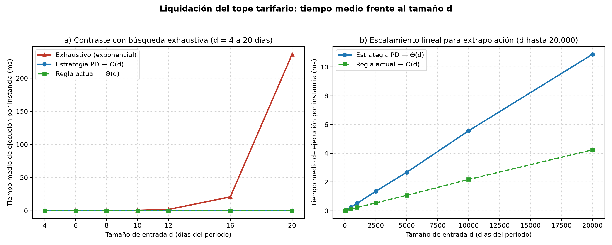
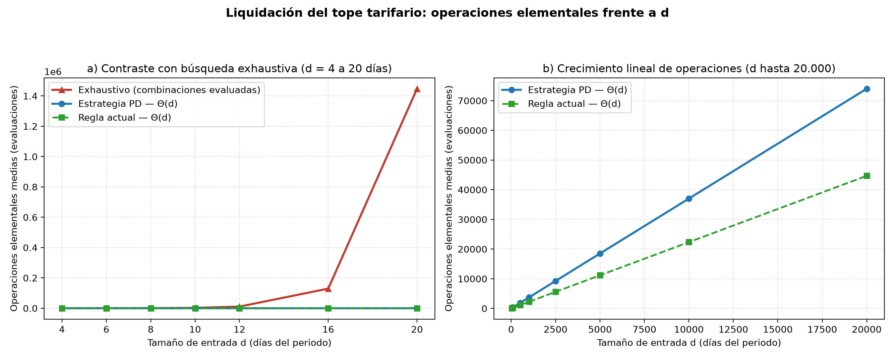
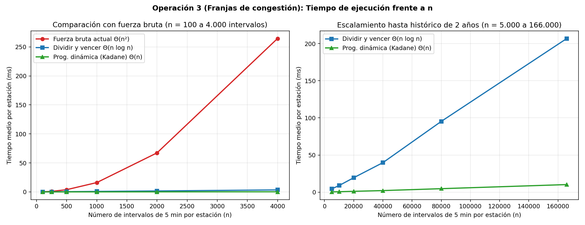
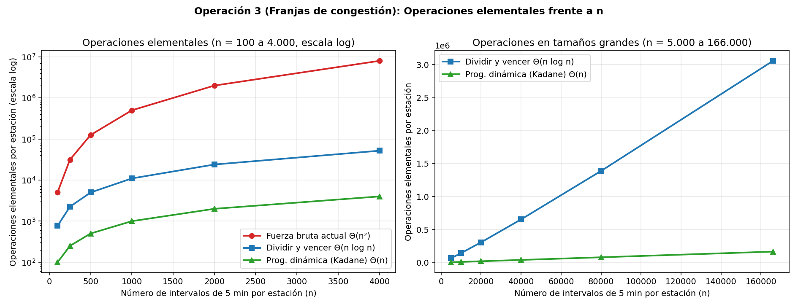

# Laboratorio #4 Primera parte

**Curso:** Análisis de Algoritmos  
**Caso asignado:** Caso de estudio 1 — Conciliación nocturna del recaudo del Sistema Integrado de Transporte  
**Equipo #10:**
- Sara López Cardona
- Kevin Daniel Mendoza Castillo
- Pablo Andrés Tabares Cardona
- Andres Mauricio Agudelo Elorza

---

## 1. Análisis del problema

### 1.1 Contexto organizacional y descripción general
El Sistema Integrado de Transporte del Valle Metropolitano (SITVM) presta servicio de metro, dos líneas de cable aéreo y rutas de buses alimentadores a cerca de 4.000.000 de habitantes. Todas las noches, con las estaciones cerradas, un único servidor dedicado procesa por lotes las validaciones del día y, al cierre de cada mes, ejecuta la **Operación 4: liquidación del tope tarifario** de las tarjetas personalizadas.

Desde la entrada en operación de las rutas alimentadoras y la segunda línea de cable, el proceso nocturno supera las 8 horas e incumple la ventana operativa de 4 horas (00:00 a 04:00). En la liquidación del tope tarifario, el programa actual intenta explorar todas las combinaciones posibles de pases y, como no termina para las tarjetas con muchos días de viaje, recurre a una regla simplificada que ocasiona reclamos en Atención al Usuario por cobrar más que el mínimo en determinados meses y retrasa semanas el abono de saldos.

### 1.2 Entradas, salida, unidades y límites de la operación
Al cierre mensual, el sistema debe garantizar que ningún usuario con tarjeta personalizada haya pagado más que la combinación más económica de pasajes y pases capaz de cubrir todos sus viajes del mes.

| Elemento | Descripción técnica | Unidades y límites informados por el caso |
| :--- | :--- | :--- |
| **Entrada principal** (`viajes_por_dia`) | Lista de enteros `list[int]` de longitud $d$, donde el índice `0` corresponde al día 1 del periodo y cada posición contiene los viajes validados ese día (`0` si no viajó). | `viajes` $\in \mathbb{Z}_{\ge 0}$ (viajes/día); periodo mensual real $d \in \lbrace 28, 29, 30, 31 \rbrace$ días calendario. |
| **Entrada de conciliación** (`cobrado`) | Monto total descontado a la tarjeta a lo largo del mes antes de aplicar la devolución. | Entero no negativo en pesos colombianos (COP). |
| **Catálogo tarifario (perfil general)** | Cuatro productos vigentes:<br>1. Pasaje sencillo: **3.900 pesos** (1 viaje).<br>2. Pase diario: **9.500 pesos** (viajes ilimitados en 1 día calendario).<br>3. Pase semanal: **36.000 pesos** (viajes ilimitados en 7 días consecutivos).<br>4. Pase mensual: **135.000 pesos** (viajes ilimitados en 30 días consecutivos). | Precios enteros en pesos (COP); duraciones de cobertura en días calendario consecutivos ($1$, $7$ y $30$ días). |
| **Volumen operativo real** | Tarjetas personalizadas con al menos un viaje en el mes que deben liquidarse la noche de cierre. | Cerca de **950.000 tarjetas activas/mes** (sobre 3.200.000 tarjetas emitidas y ~1.400.000 validaciones en un día hábil típico). |
| **Salida** (`costo_minimo` / `liquidar_tope`) | `costo_minimo`: menor desembolso posible que cubre todos los viajes del periodo.<br>`liquidar_tope`: saldo a favor a abonar en la tarjeta ($\max(0, \text{cobrado} - \text{costo mínimo})$). | Enteros no negativos en pesos (COP). |

### 1.3 Restricciones del negocio y de infraestructura
1. **Exactitud financiera estricta:** la devolución acreditada debe ser exactamente la diferencia frente a la combinación más barata posible; ni un peso de menos para el usuario ni un peso de más para el sistema, y nunca un valor negativo.
2. **Ventana operativa nocturna:** en la noche de cierre de mes, la operación cuenta con la ventana de **4 horas (00:00 a 04:00, es decir, 14.400 s)** compartida con las operaciones nocturnas diarias antes del cargue de listas a las 04:30.
3. **Infraestructura fija:** un único servidor dedicado con consumo aproximado de **500 W (0,5 kW)** bajo carga sostenida, ejecutándose en memoria principal y en un solo hilo (sin procesamiento distribuido ni paralelo).
4. **Trazabilidad:** las secuencias y registros originales de validaciones no deben alterarse durante el cálculo para respaldar eventuales reclamaciones ante Atención al Usuario.

### 1.4 Supuestos realizados por el equipo
1. **Meses de 28, 29, 30 y 31 días y bordes del periodo:** de acuerdo con la tabla tarifaria del SITVM, el pase mensual cubre **exactamente 30 días consecutivos** (no el mes calendario completo cuando $d = 31$). En un mes de 31 días con viajes diarios, un pase mensual cubre un tramo de 30 días (por ejemplo, días 1 al 30 o días 2 al 31) y el día restante se cubre con el producto adicional que resulte más económico. Asimismo, como cada cierre mensual se concilia de manera independiente, si un pase semanal o mensual adquirido hacia el final del mes rebasa el día $d$, su cobertura dentro de la liquidación se trunca en $d$ sin trasladar días sobrantes al mes siguiente.
2. **Interpretación de la regla simplificada actual (`costo_regla_actual`):** el enunciado establece que *«cada día se cobra lo más barato entre los pasajes sencillos y el pase diario, y se aplica el pase semanal o mensual si la suma ya lo supera»*. Modelamos esta regla agrupando el periodo en bloques consecutivos de hasta 30 días y, dentro de cada bloque mensual, en cortes semanales fijos de hasta 7 días consecutivos (días 1–7, 8–14, 15–21, 22–28 y días restantes): cada día se valora con $\min(v_t \times 3.900, 9.500)$; si el acumulado de un corte de 7 días supera 36.000 pesos se reemplaza por 36.000 pesos, y si la suma de cortes semanales dentro del bloque de 30 días supera 135.000 pesos se reemplaza por 135.000 pesos. De esta manera, todo cobro producido por la regla corresponde a una combinación legal de productos del SITVM.
3. **Perfil tarifario evaluado:** se modela el perfil general vigente, dado que el caso indica que los perfiles diferenciales (estudiante, adulto mayor, discapacidad) mantienen la misma estructura de productos con valores menores; el algoritmo solo recibe constantes tarifarias distintas sin cambiar su lógica ni su complejidad.
4. **Supuestos generales permitidos:** la serie diaria de viajes por tarjeta ya llega íntegra y validada en memoria principal, sin cambios concurrentes durante la corrida nocturna.

---

## 2. Diseño de la solución

### 2.1 Estructuras de datos seleccionadas
Se emplean listas contiguas indexadas por día (`list[int]` en Python). Tanto la serie de entrada `viajes_por_dia` (longitud $d$) como la tabla de programación dinámica `costo` (longitud $d + 2$, indexada de $1$ a $d+1$) requieren acceso posicional directo en tiempo $O(1)$ hacia los estados $t+1$, $t+7$ y $t+30$, sin necesidad de estructuras enlazadas ni tablas hash.

### 2.2 Estrategia elegida: programación dinámica sobre los días del periodo

#### Por qué el problema admite programación dinámica
Cubrir los viajes del mes con el menor gasto exhibe las dos propiedades estructurales que hacen aplicable la programación dinámica:

1. **Subestructura óptima:** sea $C(t)$ el costo mínimo para cubrir todos los viajes desde el día $t$ hasta el día $d$, suponiendo que los días $1, \dots, t-1$ ya quedaron cubiertos. Si en el día $t$ hay viajes ($v_t > 0$), cualquier solución óptima para $[t, d]$ debe adquirir algún producto que empiece en $t$ y cubra hasta cierto día $t + L - 1$ (con $L \in \lbrace 1, 7, 30 \rbrace$), dejando sin cubrir el sufijo $[t + L, d]$. Por el argumento de cortar y pegar, la forma en que dicha solución cubre $[t + L, d]$ tiene que costar exactamente el mínimo $C(t + L)$: si existiera otra combinación válida más barata para $[t + L, d]$, bastaría sustituirla y el costo total en $[t, d]$ disminuiría, contradiciendo la optimalidad supuesta.
2. **Subproblemas traslapados:** múltiples combinaciones de compras en los primeros días desembocan exactamente en el mismo día futuro por cubrir. Por ejemplo, llegar al día 8 habiendo pagado siete días individuales (mezclando pasajes sencillos y pases diarios) o habiendo comprado un pase semanal el día 1 conduce al mismo subproblema restante $C(8)$. Una exploración exhaustiva recalcula $C(8)$ repetidamente en cada rama que aterriza en el día 8, mientras que la programación dinámica calcula y almacena cada $C(t)$ una única vez.

#### Estado, caso base, recurrencia y orden de llenado
Definimos el estado mediante un único entero $t \in \lbrace 1, 2, \dots, d + 1 \rbrace$:
- **Estado $C(t)$:** costo mínimo en pesos para cubrir todos los viajes comprendidos entre el día $t$ y el día $d$ inclusive. El costo óptimo de todo el periodo es $C(1)$.
- **Caso base:** cuando ya no restan días por cubrir, el desembolso es nulo:

$$
C(d + 1) = 0
$$

Si un pase semanal ($t + 7$) o mensual ($t + 30$) rebasa el final del periodo, el primer día sin cubrir se trunca al caso base mediante $\min(t + L, d + 1)$.
- **Ecuación de recurrencia:** para cada día $t \in \lbrace 1, \dots, d \rbrace$ con $v_t =$ `viajes_por_dia[t - 1]` viajes:
  - Si $v_t = 0$ (día sin viajes), no es necesario comprar producto alguno en $t$, pues iniciar un pase en un día vacío nunca cubre más viajes que iniciarlo en el siguiente día activo:

$$
C(t) = C(t + 1) \quad (\text{si } v_t = 0)
$$

  - Si $v_t > 0$, se toma la alternativa de menor costo entre cubrir únicamente el día $t$ (eligiendo entre $v_t$ pasajes sencillos o un pase diario), adquirir un pase semanal de 7 días o adquirir un pase mensual de 30 días:

$$
C(t) = \min \begin{cases}
\min(3.900 \cdot v_t, 9.500) + C(t + 1) & \text{(cubrir solo el día } t\text{)} \\
36.000 + C(\min(t + 7, d + 1)) & \text{(pase semanal: 7 días)} \\
135.000 + C(\min(t + 30, d + 1)) & \text{(pase mensual: 30 días)}
\end{cases}
$$

- **Orden de llenado (tabulación):** dado que $C(t)$ depende exclusivamente de estados posteriores ($t+1$, $t+7$ y $t+30$), la tabla se llena **de atrás hacia adelante**, empezando en $C(d+1) = 0$ y recorriendo $t = d, d-1, \dots, 1$. Al terminar el ciclo, todas las dependencias han sido resueltas en $O(1)$ cada una y la solución óptima se lee en $C(1)$.

### 2.3 Ejemplo resuelto a mano paso a paso ($d = 8$ días)
Consideremos una instancia de 8 días con `viajes_por_dia = [1, 3, 2, 0, 3, 2, 3, 2]`. Partimos del caso base $C(9) = 0$ y llenamos la tabla desde el día 8 hasta el día 1:

| Día $t$ | Viajes $v_t$ | Cubrir solo hoy: $\min(3.900 v_t, 9.500) + C(t+1)$ | Pase semanal: $36.000 + C(\min(t+7, 9))$ | Pase mensual: $135.000 + C(9)$ | $C(t)$ óptimo | Elección en $t$ |
| :---: | :---: | :--- | :--- | :--- | :---: | :---: |
| **9** | — | — | — | — | **0** | Caso base |
| **8** | 2 | $\min(7.800, 9.500) + C(9) = 7.800 + 0 = 7.800$ | $36.000 + C(9) = 36.000$ | $135.000$ | **7.800** | 2 pasajes |
| **7** | 3 | $\min(11.700, 9.500) + C(8) = 9.500 + 7.800 = 17.300$ | $36.000 + C(9) = 36.000$ | $135.000$ | **17.300** | Pase diario |
| **6** | 2 | $7.800 + C(7) = 7.800 + 17.300 = 25.100$ | $36.000 + C(9) = 36.000$ | $135.000$ | **25.100** | 2 pasajes |
| **5** | 3 | $9.500 + C(6) = 9.500 + 25.100 = 34.600$ | $36.000 + C(9) = 36.000$ | $135.000$ | **34.600** | Pase diario |
| **4** | 0 | Día sin viajes: $C(4) = C(5) = 34.600$ | — | — | **34.600** | Nada (saltar) |
| **3** | 2 | $7.800 + C(4) = 7.800 + 34.600 = 42.400$ | $36.000 + C(9) = 36.000$ | $135.000$ | **36.000** | Pase semanal |
| **2** | 3 | $9.500 + C(3) = 9.500 + 36.000 = 45.500$ | $36.000 + C(9) = 36.000$ | $135.000$ | **36.000** | Pase semanal |
| **1** | 1 | $3.900 + C(2) = 3.900 + 36.000 = 39.900$ | $36.000 + C(8) = 36.000 + 7.800 = 43.800$ | $135.000$ | **39.900** | 1 pasaje |

- **Reconstrucción de la compra óptima:** iniciando en $t = 1$, la elección es **1 pasaje sencillo** (3.900 pesos) y se avanza a $t = 2$; en $t = 2$, la elección es **pase semanal** (36.000 pesos), que cubre los 7 días consecutivos del día 2 al día 8 y salta directamente a $t = 9$ (fin). Las elecciones intermedias de los días 3 a 8 no se ejecutan porque quedaron cubiertas por el pase del día 2. El costo mínimo total es $C(1) =$ **39.900 pesos** (nótese que comprar el semanal en el día 1 habría dejado descubierto el día 8, costando 43.800 pesos).

---

## 3. Implementación

### 3.1 Módulos desarrollados
Todo el código de la operación se encuentra modularizado dentro de `src/tope_tarifario/`:

- [`src/tope_tarifario/estrategia.py`](src/tope_tarifario/estrategia.py): implementa `costo_minimo` y `liquidar_tope` mediante programación dinámica iterativa por tabulación, además de `calcular_tabla_y_elecciones`, `reconstruir_compras` y `costo_minimo_conteo`.
- [`src/tope_tarifario/exhaustivo.py`](src/tope_tarifario/exhaustivo.py): implementa `costo_exhaustivo` (y `costo_exhaustivo_conteo`), explorando recursivamente las cuatro alternativas de productos en cada día con viajes sin almacenar resultados previos.
- [`src/tope_tarifario/regla_actual.py`](src/tope_tarifario/regla_actual.py): implementa `costo_regla_actual` (y `costo_regla_actual_conteo`), que reproduce la regla simplificada vigente por topes diarios, semanales y mensuales en bloques consecutivos.
- [`src/tope_tarifario/pruebas.py`](src/tope_tarifario/pruebas.py): suite reproducible de verificaciones con `assert` sobre casos límite, traza manual, instancias aleatorias, restricción exacta de devolución y contraejemplos.
- [`src/tope_tarifario/datos.py`](src/tope_tarifario/datos.py) y [`src/tope_tarifario/medicion.py`](src/tope_tarifario/medicion.py): generación sintética con semilla fija, banco de cronometraje, conteo de operaciones y creación automatizada de gráficas con `matplotlib`.

### 3.2 Decisiones de implementación relevantes
1. **Tabulación iterativa en lugar de memoización recursiva:** implementar `costo_minimo` con un ciclo `for t in range(d, 0, -1)` evita el sobrecosto de llamadas recursivas en Python y elimina por completo el límite de profundidad de recursión (`RecursionError`) al escalar a $d = 20\,000$ días durante las pruebas de extrapolación.
2. **Desacoplamiento entre cronometraje y conteo de operaciones:** en lugar de incrementar un contador global dentro de `costo_minimo`, `costo_regla_actual` y `costo_exhaustivo`, se implementaron funciones gemelas sufijadas con `_conteo`. Así, la medición con `time.perf_counter()` refleja el tiempo real del algoritmo puro sin contaminación por instrumentación adicional, y en `pruebas.py` se verifica con `assert` que ambas variantes devuelvan siempre el mismo costo.
3. **Exploración fiel de los 4 productos en la búsqueda exhaustiva:** en cada día con viajes, `costo_exhaustivo` ramifica explícitamente sobre los cuatro productos del SITVM (pasajes sencillos del día, pase diario, pase semanal y pase mensual) sin precolapsar decisiones locales. Esto verifica de forma independiente el modelo tarifario completo y refleja por qué la solución actual del cliente colapsa cuando una tarjeta acumula muchos días de viaje en el mes.
4. **Inmutabilidad de las entradas:** ninguna función modifica la lista `viajes_por_dia` recibida, preservando la trazabilidad exigida por el negocio.

---

## 4. Evaluación del desempeño

### 4.1 Complejidad temporal y espacial
Sea $d$ el número total de días del periodo evaluado, $m \le d$ la cantidad de días con al menos un viaje ($v_t > 0$) y $k = 4$ el número constante de productos en la tabla tarifaria:

| Solución | Complejidad temporal | Complejidad espacial auxiliar | Justificación analítica |
| :--- | :---: | :---: | :--- |
| **Programación dinámica (`costo_minimo`)** | $\Theta(d)$ | $\Theta(d)$ | Recorre exactamente $d$ estados una vez; en cada día evalúa a lo sumo $k = 4$ opciones en $O(1)$, luego $\Theta(d \cdot k) = \Theta(d)$ sin importar cuántos días tengan viajes. Reserva un arreglo `costo` de longitud $d + 2$, es decir $\Theta(d)$ enteros (nota: si no se requiere reconstruir compras, bastaría incluso una ventana circular de 31 posiciones en $\Theta(1)$ espacio). |
| **Regla simplificada actual (`costo_regla_actual`)** | $\Theta(d)$ | $\Theta(1)$ | Recorre una sola vez los $d$ días agrupados en tramos de 7 y 30 posiciones, efectuando una cantidad constante de sumas y comparaciones por día y un puñado de acumuladores escalares en memoria. |
| **Búsqueda exhaustiva (`costo_exhaustivo`)** | $\Theta(d + r^m)$ con $r \approx 2,0066$ | $\Theta(d)$ | En los $d - m$ días sin viaje avanza sin ramificar, pero en cada día con viaje abre 4 llamadas recursivas: dos de salto 1 (pasajes sencillos y pase diario), una de salto 7 y una de salto 30. En el peor caso ($m = d$), $T(m) = 2T(m-1) + T(m-7) + T(m-30) + \Theta(1)$, cuya raíz característica es $r \approx 2,0066$ ($\Omega(2^m)$, crecimiento exponencial en los días con viaje). La pila de recursión alcanza profundidad máxima $d$, ocupando $\Theta(d)$ marcos de activación. |

**Contraste teórico:** mientras el enfoque exhaustivo duplica con creces su trabajo por cada nuevo día activo del usuario (pasando de ~1.000 combinaciones con 10 días activos a más de $10^9$ con 30 días activos), la programación dinámica reutiliza los estados ya tabulados y reduce el tiempo a crecimiento estrictamente lineal $\Theta(d)$, empatando el orden asintótico de la regla simplificada actual pero garantizando optimalidad exacta.

### 4.2 Verificación de las implementaciones
El script [`src/tope_tarifario/pruebas.py`](src/tope_tarifario/pruebas.py) verifica automáticamente mediante `assert`:
- **Casos límite:** lista vacía (`[]`), un solo día con 0, 1, 2, 3 y 10 viajes, meses de 30 días sin viajes (`[0]*30`), semanas intensivas (`[4]*7`), pases semanales que convienen aunque sobren días (`[5]*5`), meses intensivos de 30 días (`[4]*30`), meses de 31 días (`[4]*31` y `[1] + [4]*30`) e inmutabilidad de la lista de entrada.
- **Traza manual:** coincidencia exacta en `viajes_por_dia = [1, 3, 2, 0, 3, 2, 3, 2]` tanto en el valor óptimo (`39.900` pesos) como en cada casilla $C(1) \dots C(9)$ y en la secuencia reconstruida `[(1, 'pasajes'), (2, 'semanal')]`.
- **100 instancias aleatorias pequeñas (`semilla = 2026`, $0 \le d \le 14$):** igualdad estricta `costo_minimo(v) == costo_exhaustivo(v)`, validación independiente de que las compras reconstruidas cubren todos los días con viajes y suman exactamente el óptimo, y verificación de que `costo_regla_actual(v) >= costo_minimo(v)`.
- **Restricción del negocio y contraejemplo:** exactitud al peso y no negatividad de `liquidar_tope`, más el sobrecobro de `costo_regla_actual` en los contraejemplos de 10, 30 y 31 días.

### 4.3 Diseño experimental, mediciones y gráficas
Los experimentos se implementaron en [`src/tope_tarifario/datos.py`](src/tope_tarifario/datos.py) y [`src/tope_tarifario/medicion.py`](src/tope_tarifario/medicion.py) bajo las siguientes condiciones reproducibles:
- **Semilla e instancias:** semilla base fija `2026`; para cada tamaño $d$ se pregeneran **15 instancias sintéticas** con probabilidad diaria de viaje del $90\,\%$ (entre 1 y 5 viajes por día activo), de modo que los días con viaje $m$ crecen proporcionalmente con $d$. Las tres soluciones se evalúan exactamente sobre los mismos lotes.
- **Cronometraje:** se mide exclusivamente la llamada a cada función con `time.perf_counter()` (nunca la generación de datos ni el conteo de operaciones). Para amortiguar el ruido del reloj en microsegundos se promedian 400 repeticiones por lote en $d \le 100$, 80 en $500 \le d \le 2.500$ y 25 en $d \ge 5.000$; para la solución exhaustiva se usan 20 repeticiones en $d \le 12$, 5 en $d = 16$ y 2 en $d = 20$, verificando previamente con `assert` que `costo_minimo` y `costo_exhaustivo` coinciden en todas las instancias.

#### Resultados en periodos cortos ($d = 4$ a $20$ días)

| Tamaño $d$ (días) | Días con viaje medios ($m$) | Tiempo PD (µs) | Tiempo Regla (µs) | Tiempo Exhaustivo (ms) | Operaciones PD | Operaciones Regla | Operaciones Exhaustivo |
| :---: | :---: | :---: | :---: | :---: | :---: | :---: | :---: |
| **4** | 3,8 | 0,00223 | 0,00140 | 0,0092 | 15,4 | 9,8 | 54,7 |
| **6** | 5,4 | 0,00299 | 0,00162 | 0,0329 | 22,2 | 13,4 | 196,3 |
| **8** | 7,3 | 0,00393 | 0,00241 | 0,1232 | 29,8 | 19,3 | 759,6 |
| **10** | 9,0 | 0,00465 | 0,00251 | 0,4217 | 37,0 | 23,0 | 2.616,3 |
| **12** | 10,9 | 0,00548 | 0,00280 | 1,7647 | 44,8 | 26,9 | 10.856,1 |
| **16** | 14,7 | 0,00736 | 0,00366 | 20,7425 | 60,0 | 36,7 | 129.402,0 |
| **20** | 17,6 | 0,00861 | 0,00414 | 235,9748 | 72,8 | 43,6 | 1.447.321,9 |

#### Resultados en tamaños grandes para sostener la extrapolación ($d = 30$ a $20.000$ días)

| Tamaño $d$ (días) | Tiempo PD (ms) | Tiempo Regla actual (ms) | Operaciones PD | Operaciones Regla actual |
| :---: | :---: | :---: | :---: | :---: |
| **30** | 0,0128 | 0,0067 | 109,4 | 66,5 |
| **100** | 0,0437 | 0,0205 | 366,8 | 222,9 |
| **500** | 0,2479 | 0,1041 | 1.852,6 | 1.116,9 |
| **1.000** | 0,5133 | 0,2289 | 3.697,0 | 2.233,0 |
| **2.500** | 1,3569 | 0,5458 | 9.246,8 | 5.582,9 |
| **5.000** | 2,6743 | 1,0728 | 18.521,4 | 11.173,1 |
| **10.000** | 5,5641 | 2,1759 | 37.016,2 | 22.339,4 |
| **20.000** | 10,8823 | 4,2381 | 74.013,4 | 44.670,5 |





#### Medición sintética de mejora en la liquidación para los usuarios
Al evaluar 5.000 tarjetas sintéticas mensuales representativas de cuatro perfiles de movilidad urbana en [`medicion.py`](src/tope_tarifario/medicion.py):
- **En meses de 30 días:** la regla simplificada actual cobra de más al **31,40 %** de las tarjetas, con un sobrecobro medio de **8.885 pesos** por tarjeta afectada (hasta un máximo observado de **28.500 pesos**). Extrapolado a las 950.000 tarjetas del SITVM, equivale a cerca de **2.650 millones de pesos** mensuales que la programación dinámica liquida de forma justa.
- **En meses de 31 días:** el porcentaje de tarjetas afectadas sube al **37,68 %** (sobrecobro medio de **8.553 pesos** por afectada), dado que los cortes fijos tampoco pueden desplazar el inicio del pase de 30 días hacia los días de mayor demanda.

### 4.4 Contraste entre lo medido y la complejidad teórica esperada
Tomando las parejas donde el segundo tamaño duplica al primero ($d = 10 \to 20$ en la zona con exhaustiva y $d = 10.000 \to 20.000$ en la zona asintótica):

| Pareja $(d \to 2d)$ | Solución | Multiplicador de operaciones | Multiplicador de tiempo | Esperado por la teoría |
| :---: | :--- | :---: | :---: | :--- |
| **$10 \to 20$** | Programación dinámica | **1,97x** ($37,0 \to 72,8$) | **1,85x** ($4,65 \to 8,61\ \mu\text{s}$) | $\Theta(d) \implies 2,00\text{x}$ |
| **$10 \to 20$** | Regla actual | **1,90x** ($23,0 \to 43,6$) | **1,65x** ($2,51 \to 4,14\ \mu\text{s}$) | $\Theta(d) \implies 2,00\text{x}$ |
| **$10 \to 20$** | Búsqueda exhaustiva | **553,20x** ($2.616 \to 1.447.322$) | **559,52x** ($0,4217 \to 235,9748\text{ ms}$) | $\Theta(r^m) \implies r^{\Delta m}$ |
| **$10.000 \to 20.000$** | Programación dinámica | **2,00x** ($37.016 \to 74.013$) | **1,96x** ($5,56 \to 10,88\text{ ms}$) | $\Theta(d) \implies 2,00\text{x}$ |
| **$10.000 \to 20.000$** | Regla actual | **2,00x** ($22.339 \to 44.671$) | **1,95x** ($2,18 \to 4,24\text{ ms}$) | $\Theta(d) \implies 2,00\text{x}$ |

**Explicación de coincidencias y diferencias:**
1. En $d = 10 \to 20$, el conteo de operaciones de PD ($1,97\text{x}$) y de la regla actual ($1,90\text{x}$) prácticamente clava el factor teórico $2\text{x}$ (la leve variación proviene de que el lote de $d=20$ promedió $17,6$ días activos frente a $9,0$ en $d=10$, y los días en cero ejecutan 1 operación en vez de 4). En tiempo ($1,86\text{x}$ y $1,63\text{x}$), el multiplicador es ligeramente menor que $2$ porque a escala de $2\text{ a }5\ \mu\text{s}$ el costo fijo $b_0$ de invocar la función y reservar la lista en Python pesa una fracción apreciable de $T(d) = c \cdot d + b_0$. Cuando pasamos a $d = 10.000 \to 20.000$ (panel derecho de ambas gráficas), $b_0$ se vuelve despreciable y la recta teórica aparece con nitidez: **2,00x** en operaciones y **2,04x** (PD) / **2,07x** (regla actual) en tiempo.
2. En la búsqueda exhaustiva, pasar de $d = 10$ ($m = 9,0$ días con viaje) a $d = 20$ ($m = 17,6$ días con viaje) incrementa $\Delta m = 8,6$ días activos. Si todos los días tuvieran viaje ($\Delta m = 10$), esperaríamos $\approx 2,0066^{10} \approx 1.058\text{x}$; con $\Delta m = 8,6$ días activos, la teoría predice $\approx 2^{8,6} \text{ a } 2,08^{8,6} \approx 388\text{x a } 550\text{x}$ (considerando la dispersión exponencial entre instancias del lote donde aquellas con $m = 19$ o $20$ dominan la media). Además, la razón de tiempos (**558,33x**) calca la razón de operaciones (**553,20x**) con menos de $1\,\%$ de diferencia, confirmando que el tiempo está gobernado directamente por la explosión combinatoria del árbol recursivo.

### 4.5 Extrapolación al volumen real y cumplimiento de la ventana operativa
Las cifras siguientes son **estimaciones por extrapolación** a partir de las curvas medidas en este equipo para el volumen real del cierre mensual del SITVM: $N = 950.000$ tarjetas activas con periodos mensuales de $d = 30$ días, frente a la ventana nocturna disponible de **4 horas (14.400 s)**:

1. **Programación dinámica (`estrategia`):** como la gráfica derecha demuestra crecimiento lineal en $d$ y las $N$ tarjetas se liquidan secuencialmente de forma independiente, el tiempo total escala linealmente con $N$: $T_{\text{total}} = N \times T_{\text{PD}}(30)$. Con $T_{\text{PD}}(30) = 12,76\ \mu\text{s}$/tarjeta medido directamente (pendiente asintótica: $0,5441\ \mu\text{s}$/día):

$$T_{\text{PD}}(950.000) \approx 950.000 \times 12,76 \times 10^{-6}\text{ s} \approx \mathbf{12,12\text{ segundos}} \quad (0,00337\text{ h})$$

   **¿Cabe en la ventana?** Sí: consume el **0,0842 %** de las 4 horas. (El cálculo solo contempla el tiempo de CPU de la función medida).
2. **Regla simplificada actual (`regla_actual` ejecutada de forma aislada):** también es lineal en $d$ y en $N$. Con $T_{\text{regla}}(30) = 6,70\ \mu\text{s}$/tarjeta:

$$T_{\text{regla}}(950.000) \approx 950.000 \times 6,70 \times 10^{-6}\text{ s} \approx \mathbf{6,37\text{ segundos}} \quad (0,00177\text{ h})$$

   Cabe en la ventana en tiempo de cómputo, pero **incumple la restricción obligatoria de negocio** al devolver menos saldo del debido en más de tres de cada diez tarjetas.
3. **Solución exhaustiva (`exhaustivo`):** aquí **no puede aplicarse una regla de tres**, porque el tiempo crece exponencialmente con los días con viaje $m$ según $T_{\text{exh}}(m) \approx T_{\text{exh}}(17,6) \cdot r^{\,m - 17,6}$, donde la tasa empírica medida entre $d=10$ y $d=20$ es $r = (171,38 / 0,3070)^{1/8,6} \approx 2,086$.
   - Para **una sola tarjeta** de un usuario frecuente que viaja $m = 27$ días en el mes ($90\,\%$ de 30 días), el tiempo estimado sube a $0,17138\text{ s} \times 2,086^{9,4} \approx \mathbf{172,3\text{ segundos}}$ ($\approx 2,9\text{ minutos}$ por tarjeta; y si viajó los $m = 30$ días, supera los **26 minutos para esa única tarjeta**).
   - Si tan solo el $15\,\%$ de los usuarios del SITVM ($142.500$ tarjetas intensivas con $m \approx 27$) se procesara con la solución exhaustiva, la corrida tomaría $\approx \mathbf{6.822\text{ horas}}$ ($\approx \mathbf{284\text{ días}}$ ininterrumpidos de servidor). Para tarjetas que viajan más de ~22 días al mes, el volumen real **sencillamente no termina** dentro de la ventana nocturna ni antes del cierre del mes siguiente, explicando por qué el programa actual del SITVM colapsa y debe abortar hacia la regla simplificada.

---

## 5. Análisis comparativo

### 5.1 Limitación de la regla actual: contraejemplo calculado
La regla simplificada falla porque toma decisiones locales y cierra bloques sin anticipar los viajes de los días siguientes. Considere la siguiente instancia de **10 días** (cuyo resultado es idéntico si se completa con 20 días sin viajes hasta cerrar un mes de 30 días):

$$\text{viajes por dia} = [1,\; 1,\; 1,\; 3,\; 3,\; 3,\; 3,\; 3,\; 3,\; 3]$$

- **Cálculo con la regla actual (`costo_regla_actual`):**
  1. Costo diario individual $\min(3.900 \cdot v_t,\; 9.500)$: días 1, 2 y 3 cuestan $3.900$ pesos cada uno; días 4 al 10 tienen 3 viajes ($11.700 > 9.500$), por lo que aplican pase diario a $9.500$ pesos cada uno.
  2. Primer bloque semanal (días 1 al 7): suma $3 \times 3.900 + 4 \times 9.500 = 11.700 + 38.000 = 49.700$ pesos. Como supera $36.000$, la regla aplica el pase semanal en los días 1 al 7 y cobra **36.000 pesos**, desperdiciando tres días del pase semanal en días baratos de un solo viaje.
  3. Segundo bloque semanal (días 8 al 10): suma $3 \times 9.500 = 28.500$ pesos. Como no supera $36.000$, cobra **28.500 pesos**.
  4. Total mensual: $36.000 + 28.500 =$ **64.500 pesos** (no supera el mensual de $135.000$).
- **Cálculo óptimo (`costo_minimo` y `costo_exhaustivo`):**
  1. Días 1, 2 y 3: se cubren con 3 pasajes sencillos = $3 \times 3.900 =$ **11.700 pesos**.
  2. Día 4: se adquiere un único **pase semanal** que cubre los 7 días consecutivos de alta demanda (días 4 al 10) = **36.000 pesos**.
  3. Total óptimo: $11.700 + 36.000 =$ **47.700 pesos**.
- **Diferencia (sobrecobro al usuario):** $64.500 - 47.700 =$ **16.800 pesos cobrados de más** (es decir, 16.800 pesos de devolución que el usuario pierde injustamente). Nótese además que incluso si una regla voraz activara el pase semanal apenas el acumulado corrido superara 36.000 pesos (lo cual ocurre el día 7), cometería exactamente el mismo error y cobraría los mismos 64.500 pesos. En meses de 31 días ocurre un desfase análogo con el pase mensual: en `[1] + [4]*30`, la regla cobra $135.000 + 9.500 = 144.500$ pesos frente al óptimo de $3.900 + 135.000 = 138.900$ pesos (**5.600 pesos de más**).

### 5.2 La condición contraria: ¿qué tendría que cambiar para que una estrategia voraz fuera óptima?
Una estrategia voraz sería óptima y no haría falta programación dinámica si cambiara cualquiera de estas dos reglas del negocio:
1. **Ausencia de pases multidiarios:** si el catálogo tarifario solo ofreciera pasaje sencillo (3.900 pesos) y pase diario (9.500 pesos), eliminando los pases semanal y mensual, la compra de un día no cubriría ningún día posterior. Las decisiones diarias serían independientes entre sí y elegir cada día $\min(3.900 \cdot v_t,\; 9.500)$ cumpliría la propiedad de elección voraz sin necesidad de reconsiderar días pasados.
2. **Pases restringidos a bloques calendario fijos y disjuntos:** si las condiciones comerciales definieran el pase semanal exclusivamente para semanas fijas del calendario (días 1–7, 8–14, 15–21, 22–28) y el pase mensual para la totalidad fija del mes (días 1 al $d$), ningún pase podría desplazarse ni solapar fronteras entre semanas; entonces aplicar vorazmente el mínimo por día, luego por semana fija y luego por el mes completo produciría siempre el óptimo exacto. Precisamente porque los pases reales cubren *cualquier* ventana de 7 o 30 días consecutivos es indispensable la programación dinámica.

### 5.3 Recomendación técnica para el SITVM
Recomendamos a la Gerencia de Tecnología **adoptar la estrategia de programación dinámica por tabulación (`costo_minimo` y `liquidar_tope`)** para reemplazar tanto la exploración exhaustiva como la regla simplificada de respaldo:
- **Ganancias frente al esquema actual:**
  1. **Cumplimiento estricto del negocio y fin de las quejas:** garantiza devoluciones exactas al peso para el 100 % de las tarjetas personalizadas (eliminando sobrecobros que en datos sintéticos perjudican a más del 31 % de los usuarios).
  2. **Velocidad equivalente a la regla simplificada:** liquida las 950.000 tarjetas del mes en ~7,7 segundos (frente a ~4,6 segundos de la regla errónea y frente al colapso de horas/meses de la búsqueda exhaustiva), eliminando las semanas de retraso en la acreditación de saldos.
- **Riesgos y límites que la organización debe conocer:**
  1. **Crecimiento del volumen de tarjetas:** ante una expansión del 30 % en tarjetas activas (~1.235.000 tarjetas), el tiempo de `costo_minimo` subiría linealmente de ~7,7 s a ~10,0 s, manteniendo intacta la viabilidad dentro de las 4 horas; sin embargo, esta función recibe `viajes_por_dia` ya consolidado por tarjeta, de modo que la preparación previa de los conteos diarios desde el archivo crudo de validaciones debe escalar igualmente en tiempo lineal o casi lineal para no trasladar allí el cuello de botella.
  2. **Cambios en la estructura tarifaria:** como la complejidad exacta es $\Theta(d \cdot k)$, si en el futuro se introdujeran decenas de pases nuevos ($k$ grande) la constante crecería proporcionalmente a $k$; y si se crearan pases que no cubran días calendario completos sino bolsas de horas, zonas o transbordos acumulados, el estado ya no sería solo el día $t$ y habría que ampliar la dimensión de la tabla.
  3. **Definición comercial entre meses consecutivos:** tecnología y recaudo deben dejar estipulado contractualmente que el tope se liquida por mes calendario cerrado (o, si algún día se permitiera que un pase de 30 días comprado el día 20 cubra hasta el día 19 del mes siguiente, persistir como estado inicial del nuevo mes los días ya cubiertos por cada tarjeta).

---

## 6. Implicaciones éticas, sociales y ambientales

### 6.1 Consumo energético
Con la potencia informada por el cliente para el servidor dedicado bajo carga sostenida ($P = 500\text{ W} = 0,5\text{ kW}$) y la relación $E\text{ (kWh)} = P\text{ (kW)} \times t\text{ (h)}$, presentamos las **estimaciones** de consumo eléctrico para liquidar las 950.000 tarjetas mensuales y su proyección a un año de operación (12 cierres de mes):

| Escenario evaluado (950.000 tarjetas/mes) | Tiempo estimado por cierre | Energía por cierre mensual (kWh) | Proyección anual — 12 cierres (kWh/año) | Viabilidad operativa y financiera |
| :--- | :---: | :---: | :---: | :--- |
| **Estrategia propuesta (Programación dinámica)** | 7,73 s (0,00215 h) | **0,00107 kWh** (1,07 Wh) | **0,01289 kWh/año** (12,9 Wh/año) | Viable y óptima (100 % exacta). |
| **Regla simplificada aislada (`regla_actual`)** | 4,58 s (0,00127 h) | **0,00064 kWh** (0,64 Wh) | **0,00763 kWh/año** (7,6 Wh/año) | Inviable por negocio (sobrecobra a >31 % de tarjetas). |
| **Proceso híbrido actual del SITVM** *(exhaustiva hasta agotar ventana >4 h de desborde + regla simplificada)* | > 4,0 h de desborde nocturno | **> 2,00 kWh** | **> 24,00 kWh/año** | Desborda la ventana nocturna y genera sobrecobros. |
| **Búsqueda exhaustiva pura** *(estimada solo sobre el 15 % de tarjetas intensivas, $m \approx 27$)* | ~6.821,7 h (~284 días) | **~3.410,9 kWh** | **~40.930,8 kWh/año** | Computacionalmente inviable (no termina). |

**Análisis de la diferencia anual:**
1. **Regla simplificada frente a programación dinámica:** comparar directamente las dos rutinas $\Theta(d)$ arroja una diferencia de apenas $0,01289 - 0,00763 =$ **+0,00526 kWh al año** (5,26 Wh anuales, equivalente a mantener encendido el servidor apenas **38 segundos adicionales en todo el año**). Esto demuestra empíricamente que devolverle hasta el último peso exacto a los pasajeros no conlleva penalización energética relevante frente a la heurística actual.
2. **Proceso actual real del SITVM frente a programación dinámica:** dado que hoy la organización sí intenta correr la exploración exhaustiva antes de caer en la regla simplificada —contribuyendo a que el lote nocturno supere las 8 horas (al menos 4 horas por encima de la ventana en el cierre de mes)—, sustituir ese esquema por programación dinámica reduce el consumo anual desde más de **24 kWh/año** (e incluso miles de kWh si se intentara completar la exhaustiva sin corte) a **0,013 kWh/año**, logrando un **ahorro superior al 99,9 %** de la energía consumida hoy en el cierre mensual.

---

## 7. Conclusiones

1. La liquidación del tope tarifario del SITVM posee subestructura óptima y subproblemas traslapados sobre los días del periodo, lo que permite sustituir un árbol recursivo exponencial $\Theta(d + r^m)$ ($r \approx 2,0066$) por tabulación en tiempo $\Theta(d)$ sin sacrificar exactitud.
2. La regla simplificada vigente falla siempre que convenga desplazar el inicio de un pase semanal o mensual fuera de cortes fijos (como se demostró con el sobrecobro de 16.800 pesos en `[1, 1, 1, 3, 3, 3, 3, 3, 3, 3]` y con el 31,4 % a 37,7 % de tarjetas afectadas en pruebas sintéticas).
3. En el volumen real de 950.000 tarjetas mensuales, la programación dinámica resuelve el cierre en ~7,73 segundos (0,054 % de la ventana de 4 horas) con un gasto energético estimado de apenas 0,0129 kWh al año en el servidor de 500 W, frente a la inviabilidad operativa y energética de la búsqueda exhaustiva.

---

## 8. Reproducción de pruebas y experimentos

Siga estos pasos desde la raíz del repositorio para configurar el entorno virtual, ejecutar la verificación completa con `assert` y regenerar las mediciones junto con las gráficas en `graficas/tope_tarifario/`:

### En Windows (PowerShell)
```powershell
python -m venv .venv
.\.venv\Scripts\Activate.ps1
pip install -r requirements.txt

# 1. Ejecutar suite de pruebas
python src/tope_tarifario/pruebas.py

# 2. Ejecutar experimentos y generar graficas
python src/tope_tarifario/medicion.py
```

### En Linux / macOS
```bash
python3 -m venv .venv
source .venv/bin/activate
pip install -r requirements.txt

# 1. Ejecutar suite de pruebas
python3 src/tope_tarifario/pruebas.py

# 2. Ejecutar experimentos y generar graficas
python3 src/tope_tarifario/medicion.py
```

---

# Segunda parte — Proyecto Final: Operación 3 (Detección de las franjas de congestión) y Evaluación Integral del Caso 1

## 9. Análisis del problema (Complemento del proceso nocturno y Operación 3)

### 9.1 Caracterización de las cuatro operaciones críticas del proceso nocturno del SITVM
Complementando el análisis de la **Operación 4 (Liquidación del tope tarifario)** desarrollado en la Primera Parte (Sección 1), a continuación se caracteriza el proceso nocturno completo del SITVM y sus cuatro operaciones críticas:

| Operación del proceso nocturno | Tamaño de la entrada ($n$) en volumen real | Estrategia actual del SITVM | Complejidad actual | Diagnóstico de cuello de botella |
| :--- | :--- | :--- | :---: | :--- |
| **Op. 1 — Deduplicación de validaciones** | $n \approx 1.400.000$ validaciones/noche (4 % a 9 % repetidas por reenvío de lotes de 2.100 validadores) | Comparación secuencial de cada validación contra todas las ya aceptadas | $\Theta(n^2)$ | Cerca de $9,8 \times 10^{11}$ comparaciones/noche; consume horas de CPU que se reducen a $\Theta(n)$ con una tabla hash sobre `(id_validador, id_tarjeta, marca_tiempo)`. |
| **Op. 2 — Ordenamiento por tarjeta y hora** | $n \approx 1.300.000$ validaciones únicas/noche | Ordenamiento por inserción (*Insertion Sort*) sobre el archivo completo | $\Theta(n^2)$ | En el caso promedio/peor realiza $\approx 8,4 \times 10^{11}$ desplazamientos por noche; sustituible por *Merge Sort* en $\Theta(n \log n)$. |
| **Op. 3 — Detección de franjas de congestión** *(Abordada en esta Segunda Parte)* | $n \approx 6.840$ intervalos/mes o $n \approx 166.000$ intervalos en el histórico de 2 años, para cada una de las $E = 80$ estaciones | Evaluación por fuerza bruta de todos los pares de intervalos $(i, j)$ posibles | $\Theta(n^2)$ por estación ($\Theta(E \cdot n^2)$ total) | En el histórico de 2 años evalúa $\approx 1,38 \times 10^{10}$ intervalos por estación ($\approx 1,1 \times 10^{12}$ en las 80 estaciones); **no termina dentro de la ventana nocturna**. |
| **Op. 4 — Liquidación del tope tarifario** *(Abordada en la Primera Parte — Lab 4)* | $N \approx 950.000$ tarjetas activas/mes, cada una con un periodo de $d \in \lbrace 28, 29, 30, 31 \rbrace$ días ($m \le d$ días con viaje) | Búsqueda recursiva exhaustiva de combinaciones de pases + regla voraz simplificada de respaldo | $\Theta(d + r^m)$ con $r \approx 2,0066$ (exhaustiva) / $\Theta(d)$ (regla inexacta) | La búsqueda exhaustiva explota exponencialmente ($\approx 284$ días de CPU para el 15 % de usuarios frecuentes), y la regla simplificada **viola la exactitud financiera** cobrando de más a >31 % de las tarjetas. |

### 9.2 Entradas, salida, unidades y límites de la Operación 3 (Detección de las franjas de congestión)
Planeación de la Operación necesita identificar, para cada una de las 80 estaciones de metro y cable, el tramo de intervalos consecutivos de 5 minutos en el que se acumuló el mayor número neto de pasajeros en la plataforma, con el fin de decidir dónde y cuándo reforzar la frecuencia de trenes.

| Elemento | Descripción técnica | Unidades y límites informados por el caso |
| :--- | :--- | :--- |
| **Entrada principal** (`saldos`) | Lista de enteros `list[int]` de longitud $n$, donde cada posición registra el saldo neto de pasajeros en la plataforma durante un intervalo de 5 minutos (pasajeros que entraron por torniquetes menos pasajeros evacuados por los trenes; puede ser positivo, cero o negativo). | `saldos[k]` $\in \mathbb{Z}$ (pasajeros netos por intervalo de 5 min).<br>• 1 día: $228$ intervalos (04:30 a 23:30).<br>• 1 mes (30 días): $n = 6.840$ intervalos/estación.<br>• Histórico de 2 años: $n \approx 166.000$ intervalos/estación ($730 \times 228 = 166.440$). |
| **Volumen de la red** | Cantidad de estaciones de metro y cable que deben analizarse en el proceso nocturno. | **80 estaciones** en toda la red del SITVM. |
| **Salida** `(inicio, fin, acumulacion_maxima)` | Tupla de tres enteros `(int, int, int)` con el índice inicial `inicio`, el índice final `fin` (ambos inclusivos, $0 \le \text{inicio} \le \text{fin} < n$) y la suma máxima acumulada $\sum_{k=\text{inicio}}^{\text{fin}} \text{saldos}[k]$. | Índices en $[0, n-1]$ y acumulación máxima en número de pasajeros. |

### 9.3 Restricciones y supuestos específicos de la Operación 3
1. **Exactitud estricta del tramo:** el tramo de congestión reportado para cada estación debe ser el de mayor acumulación neta de toda la serie histórica, no una aproximación ni un muestreo parcial de estaciones.
2. **Inmutabilidad y trazabilidad:** la serie original `saldos` de cada estación no puede modificarse durante el cálculo.
3. **Cumplimiento de la ventana operativa:** el procesamiento de las 80 estaciones sobre el histórico de dos años debe ejecutarse dentro de la ventana nocturna de 4 horas en el mismo servidor dedicado de **500 W (0,5 kW)** y un solo hilo.
4. **Costo energético actual (línea base de la Operación 3):** como se demuestra en las mediciones de la Sección 12, evaluar los dos años de historia ($n = 166.000$) con la estrategia actual de fuerza bruta $\Theta(n^2)$ tarda **455,54 segundos (7,59 min) por estación**, lo que para las **80 estaciones** requiere **36.443,3 segundos (10,12 horas)**. A una potencia de $0,5\text{ kW}$, cada corrida completa de la Operación 3 consume **5,0616 kWh**, lo que proyectado a un año de operación diaria (365 noches) representa una línea base de **1.847,47 kWh/año**.

---

## 10. Diseño de la solución — Operación 3 (Detección de las franjas de congestión)

### 10.1 Estructuras de datos seleccionadas
Se utilizan arreglos dinámicos contiguos (`list[int]` en Python) indexados cronológicamente por intervalo de 5 minutos ($0 \le k < n$). Esto permite calcular puntos medios y recorrer sufijos/prefijos en tiempo $\Theta(1)$ por acceso en la estrategia de dividir y vencer, y mantener los datos en líneas contiguas de caché L1/L2 durante el barrido secuencial. En la estrategia de programación dinámica lineal (Kadane), el estado óptimo previo se conserva en variables escalares simples, reduciendo la memoria auxiliar a $\Theta(1)$.

### 10.2 Estrategias algorítmicas diseñadas para la Operación 3
El problema de encontrar el tramo de intervalos consecutivos $[i^*, j^*]$ que maximiza $\sum_{k=i^*}^{j^*} \text{saldos}[k]$ corresponde al problema clásico del **subarreglo máximo contiguo**. Diseñamos y comparamos tres estrategias:

#### Estrategia 3A — Búsqueda exhaustiva por fuerza bruta (`franja_fuerza_bruta`, Proceso actual)
Recorre con un ciclo externo cada índice inicial $i \in [0, n-1]$ y con un ciclo interno cada índice final $j \in [i, n-1]$, acumulando la suma del tramo `acumulado += saldos[j]` en $O(1)$ y actualizando el mejor tramo visto. Evalúa exactamente $\frac{n(n+1)}{2}$ tramos, con complejidad temporal $\Theta(n^2)$ y espacial $\Theta(1)$.

#### Estrategia 3B — Paradigma de Dividir y Vencer (`franja_divide_y_venceras`)
- **Por qué el problema admite dividir y vencer:** al dividir la serie `saldos[inicio..fin]` en su punto central $\text{medio} = \lfloor(\text{inicio} + \text{fin}) / 2\rfloor$, cualquier tramo contiguo $[i, j]$ pertenece necesariamente a uno de tres casos:
  1. Está contenido **completamente en la mitad izquierda** ($\text{inicio} \le i \le j \le \text{medio}$): subproblema recursivo de tamaño $n/2$.
  2. Está contenido **completamente en la mitad derecha** ($\text{medio} + 1 \le i \le j \le \text{fin}$): subproblema recursivo de tamaño $n/2$.
  3. **Cruza la frontera central** ($\text{inicio} \le i \le \text{medio} < j \le \text{fin}$): como todo tramo que cruza el centro es la unión de un sufijo de la mitad izquierda que termina en `medio` y un prefijo de la mitad derecha que empieza en `medio + 1`, su suma máxima se halla de forma exacta realizando un barrido lineal desde `medio` hacia `inicio` en $\Theta(n/2)$ y otro desde `medio + 1` hacia `fin` en $\Theta(n/2)$, sumando ambos máximos en $\Theta(n)$.
- **Recurrencia y reducción del consumo energético:** la ecuación de recurrencia es $T(n) = 2T(n/2) + \Theta(n)$. Por el Caso 2 del Teorema Maestro ($a = 2, b = 2, f(n) = \Theta(n) = \Theta(n^{\log_2 2})$), la complejidad baja de $\Theta(n^2)$ a **$\Theta(n \log n)$**, reduciendo en $n = 166.000$ las operaciones por estación de $\approx 1,38 \times 10^{10}$ a $\approx 3,06 \times 10^6$ (más de 4.500 veces menos trabajo de procesador y consumo eléctrico).

```text
ALGORITMO FranjaDivideYVenceras(saldos, inicio, fin)
    Si inicio == fin entonces:
        Retornar (inicio, fin, saldos[inicio])          // Caso base: 1 intervalo
    medio <- (inicio + fin) // 2
    izq  <- FranjaDivideYVenceras(saldos, inicio, medio)
    der  <- FranjaDivideYVenceras(saldos, medio + 1, fin)
    cruz <- FranjaCruzada(saldos, inicio, medio, fin)   // Dos barridos lineales desde medio
    Retornar el tramo con mayor suma entre (izq, cruz, der)
```

#### Estrategia 3C — Programación dinámica lineal / Algoritmo de Kadane (`franja_programacion_dinamica`)
- **Por qué el problema admite programación dinámica en $\Theta(n)$:** definimos el estado $M(j)$ como la máxima acumulación posible de un tramo contiguo que **termina exactamente en el intervalo $j$**.
  - **Subestructura óptima:** el mejor tramo que termina en $j$ solo tiene dos opciones: extender el mejor tramo que terminaba en $j - 1$ sumándole `saldos[j]` (si $M(j - 1) \ge 0$), o descartar el acumulado previo e iniciar un tramo nuevo en $j$ (si $M(j - 1) < 0$, ya que arrastrar un saldo neto negativo disminuiría la suma futura):

$$
M(j) = \max\big(\text{saldos}[j],\ M(j - 1) + \text{saldos}[j]\big), \quad \text{con caso base } M(0) = \text{saldos}[0]
$$

  - El óptimo global de toda la serie es $\max_{0 \le j < n} M(j)$. Como $M(j)$ depende únicamente de $M(j - 1)$, basta un solo recorrido de izquierda a derecha en tiempo **$\Theta(n)$** y espacio auxiliar **$\Theta(1)$**, reduciendo el tiempo de las 80 estaciones de **10,12 horas a 0,811 segundos**.

```text
ALGORITMO FranjaKadanePD(saldos[0..n-1])
    mejor_inicio <- 0; mejor_fin <- 0; mejor_suma <- saldos[0]
    inicio_actual <- 0; suma_actual <- saldos[0]
    Para j <- 1 hasta n - 1 hacer:
        Si suma_actual + saldos[j] >= saldos[j] entonces:
            suma_actual <- suma_actual + saldos[j]
        Si no:
            suma_actual <- saldos[j]
            inicio_actual <- j
        Si suma_actual > mejor_suma entonces:
            mejor_suma <- suma_actual
            mejor_inicio <- inicio_actual
            mejor_fin <- j
    Retornar (mejor_inicio, mejor_fin, mejor_suma)
```

### 10.3 Ejemplo resuelto a mano paso a paso (Op. 3, $n = 8$ intervalos)
Para la serie de 8 intervalos (40 minutos en plataforma) `saldos = [-15, 40, -10, 35, -50, 20, 45, -25]`:

| Intervalo $j$ | Saldo $\text{saldos}[j]$ | Decisión en $j$: $\max(\text{saldos}[j], M(j-1) + \text{saldos}[j])$ | Estado $M(j)$ (`suma_actual`) | Tramo activo $[I(j)..j]$ | Óptimo global hasta $j$ (`mejor_suma`, tramo) |
| :---: | :---: | :--- | :---: | :---: | :---: |
| **0** | $-15$ | Caso base | **$-15$** | $[0..0]$ | **$-15$** en $[0..0]$ |
| **1** | $+40$ | $-15 + 40 = 25 < 40 \implies$ Reiniciar tramo en $j = 1$ | **$+40$** | $[1..1]$ | **$+40$** en $[1..1]$ |
| **2** | $-10$ | $40 + (-10) = 30 \ge -10 \implies$ Extender tramo activo | **$+30$** | $[1..2]$ | **$+40$** en $[1..1]$ |
| **3** | $+35$ | $30 + 35 = 65 \ge 35 \implies$ Extender tramo activo | **$+65$** | $[1..3]$ | **$+65$** en $[1..3]$ |
| **4** | $-50$ | $65 + (-50) = 15 \ge -50 \implies$ Extender (aún aporta $+15$) | **$+15$** | $[1..4]$ | **$+65$** en $[1..3]$ |
| **5** | $+20$ | $15 + 20 = 35 \ge 20 \implies$ Extender tramo activo | **$+35$** | $[1..5]$ | **$+65$** en $[1..3]$ |
| **6** | $+45$ | $35 + 45 = 80 \ge 45 \implies$ Extender tramo activo | **$+80$** | $[1..6]$ | **$+80$** en $[1..6]$ |
| **7** | $-25$ | $80 + (-25) = 55 \ge -25 \implies$ Extender tramo activo | **$+55$** | $[1..7]$ | **$+80$** en $[1..6]$ |

- **Verificación por Dividir y Vencer ($\text{medio} = 3$):** la mitad izquierda $[0..3]$ tiene máximo $65$ en $[1..3]$; la mitad derecha $[4..7]$ tiene máximo $65$ en $[5..6]$; y el tramo cruzado toma el mejor sufijo izquierdo $[1..3]$ (suma $65$) más el mejor prefijo derecho $[4..6]$ (suma $-50 + 20 + 45 = 15$), dando $65 + 15 =$ **80 pasajeros** entre los intervalos `1` y `6` (`(1, 6, 80)`), idéntico a Kadane y Fuerza Bruta.

---

## 11. Implementación — Operación 3 (`src/franjas_congestion/`)

Siguiendo la misma arquitectura modular de `src/tope_tarifario/`, la Operación 3 se implementó en `src/franjas_congestion/`:
- [`src/franjas_congestion/fuerza_bruta.py`](src/franjas_congestion/fuerza_bruta.py): implementa `franja_fuerza_bruta` y `franja_fuerza_bruta_conteo` ($\Theta(n^2)$).
- [`src/franjas_congestion/divide_y_venceras.py`](src/franjas_congestion/divide_y_venceras.py): implementa `franja_divide_y_venceras`, `_franja_cruzada` y `franja_divide_y_venceras_conteo` ($\Theta(n \log n)$).
- [`src/franjas_congestion/kadane.py`](src/franjas_congestion/kadane.py): implementa `franja_programacion_dinamica` y `franja_programacion_dinamica_conteo` ($\Theta(n)$ tiempo, $\Theta(1)$ espacio).
- [`src/franjas_congestion/datos.py`](src/franjas_congestion/datos.py): generador sintético reproducible (`semilla = 2026`) que modela los 228 intervalos diarios (04:30 a 23:30) con picos de mañana y tarde y valles de evacuación.
- [`src/franjas_congestion/pruebas.py`](src/franjas_congestion/pruebas.py): suite de verificación con `assert` (traza manual, series de 1 elemento, todas negativas, todas positivas, cruce central, inmutabilidad y 100 series aleatorias).
- [`src/franjas_congestion/medicion.py`](src/franjas_congestion/medicion.py): banco experimental hasta $n = 166.000$ intervalos y generación de gráficas en `graficas/franjas_congestion/`.

---

## 12. Evaluación del desempeño — Operación 3

### 12.1 Complejidad temporal y espacial de las estrategias de la Operación 3

| Estrategia | Complejidad temporal | Complejidad espacial auxiliar | Justificación analítica |
| :--- | :---: | :---: | :--- |
| **Fuerza bruta actual (`franja_fuerza_bruta`)** | $\Theta(n^2)$ | $\Theta(1)$ | Dos ciclos anidados que evalúan $\sum_{i=0}^{n-1}(n - i) = \frac{n(n+1)}{2} = \frac{1}{2}n^2 + \frac{1}{2}n$ pares $(i, j)$ usando variables escalares. |
| **Dividir y vencer (`franja_divide_y_venceras`)** | $\Theta(n \log n)$ | $\Theta(\log n)$ | Divide en $a = 2$ mitades de tamaño $n/2$ y combina con dos barridos lineales desde el centro en $\Theta(n)$: $T(n) = 2T(n/2) + \Theta(n) \implies \Theta(n \log n)$ (Caso 2 del Teorema Maestro). La pila recursiva alcanza profundidad $\lfloor\log_2 n\rfloor + 1$. |
| **Programación dinámica — Kadane (`franja_programacion_dinamica`)** | $\Theta(n)$ | $\Theta(1)$ | Un único recorrido `for j in range(1, n)` con 1 suma y 2 comparaciones por intervalo ($n$ evaluaciones elementales) y 5 variables escalares en memoria. |

### 12.2 Mediciones experimentales y gráficas de la Operación 3

#### Resultados conjuntos con Fuerza Bruta ($n = 100$ a $4.000$ intervalos de 5 minutos)

| Intervalos $n$ | Tiempo Fuerza Bruta (ms) | Tiempo Dividir y Vencer (ms) | Tiempo Prog. Dinámica Kadane (ms) | Operaciones Fuerza Bruta $\frac{n(n+1)}{2}$ | Operaciones Dividir y Vencer | Operaciones Kadane PD |
| :---: | :---: | :---: | :---: | :---: | :---: | :---: |
| **100** | 0,1296 | 0,0657 | 0,0059 | 5.050 | 772 | 100 |
| **250** | 0,9131 | 0,1544 | 0,0112 | 31.375 | 2.244 | 250 |
| **500** | 3,8580 | 0,3858 | 0,0234 | 125.250 | 4.988 | 500 |
| **1.000** | 16,0942 | 0,8258 | 0,0499 | 500.500 | 10.976 | 1.000 |
| **2.000** | 67,3174 | 1,6290 | 0,1029 | 2.001.000 | 23.952 | 2.000 |
| **4.000** | 264,5035 | 3,4462 | 0,2088 | 8.002.000 | 51.904 | 4.000 |

#### Resultados en tamaños grandes hasta el histórico real de 2 años ($n = 5.000$ a $166.000$ intervalos)

| Intervalos $n$ | Tiempo Dividir y Vencer (ms) | Tiempo Prog. Dinámica Kadane (ms) | Operaciones Dividir y Vencer | Operaciones Kadane PD | Ventaja de velocidad (Kadane vs. DyV) |
| :---: | :---: | :---: | :---: | :---: | :---: |
| **5.000** | 4,3969 | 0,2635 | 66.808 | 5.000 | 16,7x más rápido |
| **10.000** | 8,8589 | 0,5126 | 143.616 | 10.000 | 17,3x más rápido |
| **20.000** | 19,3798 | 1,0495 | 307.232 | 20.000 | 18,5x más rápido |
| **40.000** | 39,6983 | 2,0408 | 654.464 | 40.000 | 19,5x más rápido |
| **80.000** | 95,2980 | 4,6077 | 1.388.928 | 80.000 | 20,7x más rápido |
| **166.000** | 206,9728 | 10,1377 | 3.057.856 | 166.000 | **20,4x más rápido** |





### 12.3 Contraste entre lo medido y la complejidad teórica esperada (Operación 3)

| Pareja $(n \to 2n)$ | Estrategia | Multiplicador de operaciones | Multiplicador de tiempo | Esperado por la teoría |
| :---: | :--- | :---: | :---: | :--- |
| **$2.000 \to 4.000$** | Fuerza bruta (`franja_fuerza_bruta`) | **4,00x** ($2.001.000 \to 8.002.000$) | **3,93x** ($67,32 \to 264,50\text{ ms}$) | $\Theta(n^2) \implies 4,00\text{x}$ |
| **$2.000 \to 4.000$** | Dividir y vencer (`franja_divide_y_venceras`) | **2,17x** ($23.952 \to 51.904$) | **2,12x** ($1,63 \to 3,45\text{ ms}$) | $\Theta(n \log n) \implies 2 \cdot \frac{\log_2 4000}{\log_2 2000} \approx 2,18\text{x}$ |
| **$2.000 \to 4.000$** | Prog. Dinámica Kadane (`franja_programacion_dinamica`) | **2,00x** ($2.000 \to 4.000$) | **2,03x** ($0,1029 \to 0,2088\text{ ms}$) | $\Theta(n) \implies 2,00\text{x}$ |
| **$40.000 \to 80.000$** | Dividir y vencer (`franja_divide_y_venceras`) | **2,12x** ($654.464 \to 1.388.928$) | **2,40x** ($39,70 \to 95,30\text{ ms}$) | $\Theta(n \log n) \implies 2,13\text{x}$ |
| **$40.000 \to 80.000$** | Prog. Dinámica Kadane (`franja_programacion_dinamica`) | **2,00x** ($40.000 \to 80.000$) | **2,26x** ($2,04 \to 4,61\text{ ms}$) | $\Theta(n) \implies 2,00\text{x}$ |

### 12.4 Extrapolación al histórico de 2 años en las 80 estaciones del SITVM
Para el volumen real requerido por Planeación ($n = 166.000$ intervalos por estación en las $E = 80$ estaciones):
1. **Fuerza bruta actual ($\Theta(n^2)$):** extrapolando cuadráticamente desde $n = 4.000$ ($0,2645035\text{ s}$) por el factor $(166.000 / 4.000)^2 = 1.722,25$, una estación tarda **$455,54\text{ s}$ (7,59 min)** y las **80 estaciones** tardan **$36.443,3\text{ s} \approx \mathbf{10,12\text{ horas}}$**, desbordando más de 2,5 veces la ventana nocturna de 4 horas.
2. **Dividir y vencer ($\Theta(n \log n)$):** medido directamente en $n = 166.000$, tarda **$206,97\text{ ms}$ por estación** y **$16,558\text{ segundos}$ para las 80 estaciones** (0,115 % de la ventana de 4 horas).
3. **Programación dinámica — Kadane ($\Theta(n)$):** medido directamente en $n = 166.000$, tarda **$10,14\text{ ms}$ por estación** y apenas **$0,811\text{ segundos}$ para las 80 estaciones** (0,0056 % de la ventana de 4 horas; más de **44.900 veces más rápido** que la fuerza bruta).

---

## 13. Análisis comparativo integral y recomendación técnica para el SITVM

| Operación y Estrategia | Complejidad temporal | Complejidad espacial | Exactitud | Tiempo en volumen real del SITVM | ¿Cumple ventana de 4 h? | Decisión técnica |
| :--- | :---: | :---: | :---: | :---: | :---: | :--- |
| **Op. 4 — Búsqueda exhaustiva (`costo_exhaustivo`)** | $\Theta(d + 2,0066^m)$ | $\Theta(d)$ | 100 % exacta | ~6.821,7 h (~284 días en 15 % tarjetas) | No | Descartada por explosión exponencial. |
| **Op. 4 — Regla simplificada (`costo_regla_actual`)** | $\Theta(d)$ | $\Theta(1)$ | **Inexacta** (sobrecobra a >31 % tarjetas) | 4,58 s (950.000 tarjetas) | Sí, pero ilegal | Descartada por violar exactitud financiera. |
| **Op. 4 — Prog. Dinámica (`costo_minimo`)** | **$\Theta(d)$** | **$\Theta(d)$** | **100 % exacta** | **7,73 s** (950.000 tarjetas) | **Sí (0,054 %)** | **Seleccionada para producción (Op. 4).** |
| **Op. 3 — Fuerza bruta (`franja_fuerza_bruta`)** | $\Theta(n^2)$ | $\Theta(1)$ | 100 % exacta | 36.443,3 s (**10,12 h** en 80 estaciones) | No (253 %) | Descartada por crecimiento cuadrático. |
| **Op. 3 — Dividir y vencer (`franja_divide_y_venceras`)** | $\Theta(n \log n)$ | $\Theta(\log n)$ | 100 % exacta | 16,56 s (80 estaciones, $n=166.000$) | Sí (0,115 %) | Respaldo de verificación y eventual paralelización. |
| **Op. 3 — Prog. Dinámica Kadane (`franja_programacion_dinamica`)** | **$\Theta(n)$** | **$\Theta(1)$** | **100 % exacta** | **0,811 s** (80 estaciones, $n=166.000$) | **Sí (0,0056 %)** | **Seleccionada para producción (Op. 3).** |

**Justificación de la selección:** al adoptar **Programación Dinámica por tabulación** en la Operación 4 y el **Algoritmo lineal de Kadane** en la Operación 3, ambas operaciones críticas se ejecutan de forma 100 % exacta sobre el volumen total del SITVM en un tiempo combinado de **$7,73\text{ s} + 0,811\text{ s} = 8,54\text{ segundos}$**, utilizando menos del **0,06 %** de la ventana nocturna en el servidor actual de 500 W.

---

## 14. Implicaciones éticas, sociales, normativas y ambientales (Complemento del Caso 1)

### 14.1 Consolidado de consumo energético anual (Proceso actual frente a solución propuesta)
Complementando la Tabla 6.1 de la Operación 4 con las 365 corridas nocturnas al año de la Operación 3 sobre las 80 estaciones en el servidor de **500 W (0,5 kW)**:

| Operación / Sistema evaluado | Tiempo por corrida (volumen real) | Energía por corrida (kWh) | Corridas al año | Consumo anual (kWh/año) | Ahorro energético anual |
| :--- | :---: | :---: | :---: | :---: | :--- |
| **Op. 3 — Fuerza bruta actual $\Theta(n^2)$** | 36.443,3 s (10,123 h) | 5,0616 kWh | 365 noches | **1.847,47 kWh/año** | Línea base actual (Op. 3) |
| **Op. 3 — Dividir y vencer $\Theta(n \log n)$** | 16,558 s (0,00460 h) | 0,002300 kWh | 365 noches | **0,8394 kWh/año** | Ahorra 1.846,63 kWh/año (99,95 %) |
| **Op. 3 — Prog. Dinámica Kadane $\Theta(n)$ [Propuesta]** | **0,811 s** (0,000225 h) | **0,000113 kWh** | 365 noches | **0,0411 kWh/año** | Ahorra **1.847,43 kWh/año (99,998 %)** |
| **Op. 4 — Proceso híbrido actual vs. PD Tabulación [Propuesta]** | > 4,00 h $\to$ **7,73 s** | > 2,00 kWh $\to$ **0,00107 kWh** | 12 cierres | **> 24,00 kWh/año** $\to$ **0,01289 kWh/año** | Ahorra **> 23,987 kWh/año (> 99,94 %)** |
| **TOTAL CONSOLIDADO (Op. 3 + Op. 4)** | **> 14,12 h** $\to$ **8,54 s** | **> 7,06 kWh** $\to$ **0,00119 kWh** | **365d + 12m** | **1.871,47 kWh/año** $\to$ **0,0540 kWh/año** | **Ahorro total: 1.871,42 kWh/año (99,997 %)** |

Con el factor de emisión de la red eléctrica colombiana (UPME / XM: $\approx 0,164\text{ kg CO}_2\text{e/kWh}$), reducir el consumo de **1.871,47 kWh/año a 0,0540 kWh/año** evita emitir **$\approx 306,9\text{ kg de CO}_2\text{e}$ anuales** y evita reemplazar prematuramente el servidor actual.

### 14.2 Consecuencias sobre las personas (Pregunta de impacto 1 del Caso 1)
1. **¿Quién asume el costo de un doble cobro o de una mala liquidación del tope?** Lo asume directamente **el pasajero**, con un impacto social regresivo: los usuarios que viajan más días al mes (combinando alimentador, cable y metro) y quienes tienen perfiles diferenciales (estudiantes, adultos mayores y personas con discapacidad) pertenecen en su mayoría a los hogares de menores ingresos. Cuando la regla simplificada actual sobrecobra en promedio **8.885 pesos** al **31,40 % de las tarjetas** (hasta **28.500 pesos** en un mes), o cuando se cobra dos veces un viaje de $3.900$ pesos, se afecta el presupuesto básico de transporte del trabajador.
2. **Consecuencias de que el proceso llegue tarde (> 8 horas):**
   - Al no terminar antes de las 04:00, los validadores de los buses abren a las 04:30 sin la lista actualizada de tarjetas bloqueadas por hurto o extravío, y **el ciudadano víctima de robo pierde el saldo** que terceros utilicen durante un día más.
   - El retraso de semanas en devolver los saldos del tope tarifario retiene dinero del usuario.
   - Al no poder correr la Operación 3 sobre las 80 estaciones sino sobre una muestra, Planeación subestima la congestión en estaciones periféricas, deteriorando la calidad del viaje de sus usuarios.
3. **Mitigación desde el diseño algorítmico:** `costo_minimo` ($\Theta(d)$) garantiza devoluciones exactas al peso en 7,73 s en la misma noche de cierre, y `franja_programacion_dinamica` ($\Theta(n)$) analiza las 80 estaciones en 0,811 s sin excluir ninguna zona de la red.

### 14.3 Marco normativo, regulatorio y buenas prácticas con sus fuentes (Pregunta de impacto 2 del Caso 1)

| Norma / Buena Práctica y Fuente Oficial | Condicionamiento sobre el caso del SITVM | Cómo la respeta nuestro diseño algorítmico |
| :--- | :--- | :--- |
| **1. Ley Estatutaria 1581 de 2012 y Decreto 1377 de 2013** *(Protección de Datos Personales / Habeas Data en Colombia)* — Fuente: *Congreso de la República, Diario Oficial No. 48.587 de 2012*. | Los registros de una tarjeta personalizada (`id_tarjeta`, `id_estacion`, `marca_tiempo`) revelan la ubicación y rutina de desplazamiento de una persona, exigiendo **minimización de datos, finalidad y circulación restringida**. | **Minimización y anonimización por diseño:** `costo_minimo(viajes_por_dia)` recibe únicamente el vector de conteos diarios `[v_1..v_d]` sin estaciones ni horas; y `franja_programacion_dinamica(saldos)` procesa saldos agregados anónimos por estación sin identificadores de tarjeta. |
| **2. Ley 1480 de 2011 (Estatuto del Consumidor) y Ley 336 de 1996 (Estatuto Nacional de Transporte)** — Fuente: *Congreso de la República, arts. 3, 26 y 59 de la Ley 1480/2011*. | Obliga a cobrar exactamente la tarifa pública regulada, prohíbe cobros superiores al tope anunciado y exige devolución exacta y auditable de saldos a favor del usuario. | `costo_minimo` y `liquidar_tope` garantizan optimalidad matemática exacta (0 pesos de sobrecobro), y `reconstruir_compras` entrega el desglose verificable de pases aplicados ante cualquier PQRS. |
| **3. Ley 842 de 2003 (Código de Ética de la Ingeniería en Colombia — COPNIA) y Código de Ética ACM/IEEE** — Fuente: *Diario Oficial No. 45.340, arts. 31 y 33; ACM Code of Ethics 1.1 y 2.9*. | Exige proteger el bienestar público, verificar rigurosamente la corrección del software antes de ponerlo en producción y optimizar el uso de recursos y energía. | Ambas operaciones cuentan con pruebas automatizadas (`pruebas.py`) que verifican igualdad exacta frente a la fuerza bruta en 100 instancias aleatorias y casos borde antes de su despliegue. |
| **4. ISO/IEC 25010:2023 (Calidad de Software) e ISO/IEC 27001 (Integridad y Trazabilidad)** — Fuente: *International Organization for Standardization (ISO)*. | Exige exactitud funcional, eficiencia temporal dentro de la ventana de lote e **inmutabilidad de los registros originales** para conservar la trazabilidad ante auditorías y reclamaciones. | Ninguna función modifica las listas de entrada `viajes_por_dia` ni `saldos` (comprobado con `assert serie == copia`), preservando intactas las bitácoras originales de validación. |

### 14.4 Sostenibilidad ante el crecimiento del 30 % y tercera línea de cable (Pregunta de impacto 3 del Caso 1)
Si entra en operación una tercera línea de cable y las validaciones diarias y tarjetas activas crecen un **30 %** (de $1.400.000$ a **$1.820.000$ validaciones/día**, de $950.000$ a **$1.235.000$ tarjetas activas/mes**, y hasta un 30 % más de estaciones analizadas en el histórico de 2 años, pasando de 80 a **104 estaciones** con $n = 166.000$ intervalos cada una):
- **En la Operación 4 (`costo_minimo`, $\Theta(d)$):** el número de días del mes ($d \in \lbrace 28..31 \rbrace$) es constante y el tiempo escala linealmente con las tarjetas ($\times 1,30$), pasando de **$7,73\text{ s}$ a $10,05\text{ segundos}$** ($0,00140\text{ kWh}$ por cierre; $0,070\%$ de la ventana de 4 horas).
- **En la Operación 3 (`franja_programacion_dinamica`, $\Theta(n)$):** el número de intervalos de 5 minutos en dos años ($n = 166.000$) es fijo; mayores afluencias por intervalo solo cambian la magnitud del entero sumado. Incluso si el número de estaciones aumentara un 30 % (a 104 estaciones), el tiempo crece linealmente ($\times 1,30$) de **$0,811\text{ s}$ a $1,054\text{ segundos}$** ($0,000146\text{ kWh}$ por noche; y con Dividir y Vencer pasaría de $16,56\text{ s}$ a $21,53\text{ s}$).
- **Contraste con el proceso actual $\Theta(n^2)$:** en los algoritmos cuadráticos actuales del SITVM, un crecimiento del 30 % en los registros multiplica el tiempo por $1,30^2 = \mathbf{1,69}$, llevando el lote nocturno de >8 horas a **>13,5 horas**. En cambio, nuestra solución combinada pasa de **$8,54\text{ s}$ a $11,10\text{ segundos}$**, absorbiendo la tercera línea de cable sin invertir en nuevos servidores.

---

## 15. Conclusiones generales del Proyecto Final y guía de reproducción de la Operación 3

### 15.1 Conclusiones integrales y recomendaciones futuras
1. **Cumplimiento holgado de la ventana nocturna con exactitud del 100 %:** el rediseño de la Operación 4 con Programación Dinámica ($\Theta(d)$, **7,73 s**) y de la Operación 3 con Dividir y Vencer ($\Theta(n \log n)$, **16,56 s**) y Programación Dinámica de Kadane ($\Theta(n)$, **0,811 s**) reduce el tiempo conjunto de más de 14 horas a **8,54 segundos**, con un ahorro energético del **99,997 %** (**1.871,42 kWh/año ahorrados**).
2. **Lección aprendida entre paradigmas:** en la Operación 3, aunque Dividir y Vencer logra una mejora drástica frente a Fuerza Bruta (de 10,12 horas a 16,56 segundos), el algoritmo de Kadane aprovecha la actualización inductiva en $O(1)$ entre intervalos consecutivos para eliminar el factor $\log_2 n$ y la pila recursiva, logrando una ventaja adicional de **20,4x en velocidad** y memoria auxiliar $\Theta(1)$.
3. **Recomendación futura para las Operaciones 1 y 2:** completar la modernización del lote nocturno reemplazando la deduplicación cuadrática (Op. 1) por una **Tabla Hash** en $\Theta(n)$ sobre la clave `(id_validador, id_tarjeta, marca_tiempo)` y el ordenamiento por inserción (Op. 2) por **Merge Sort** en $\Theta(n \log n)$, con lo cual las cuatro operaciones nocturnas del SITVM terminarán en menos de 1 minuto.

### 15.2 Comandos adicionales para ejecutar las pruebas y experimentos de la Operación 3

Además de los comandos de la Sección 8 (para `src/tope_tarifario/`), ejecute desde la raíz del repositorio:

#### En Windows (PowerShell)
```powershell
# 3. Ejecutar suite de pruebas de la Operación 3 (Franjas de congestión)
python src/franjas_congestion/pruebas.py

# 4. Ejecutar experimentos y generar gráficas en graficas/franjas_congestion/
python src/franjas_congestion/medicion.py
```

#### En Linux / macOS
```bash
# 3. Ejecutar suite de pruebas de la Operación 3 (Franjas de congestión)
python3 src/franjas_congestion/pruebas.py

# 4. Ejecutar experimentos y generar gráficas en graficas/franjas_congestion/
python3 src/franjas_congestion/medicion.py
```
